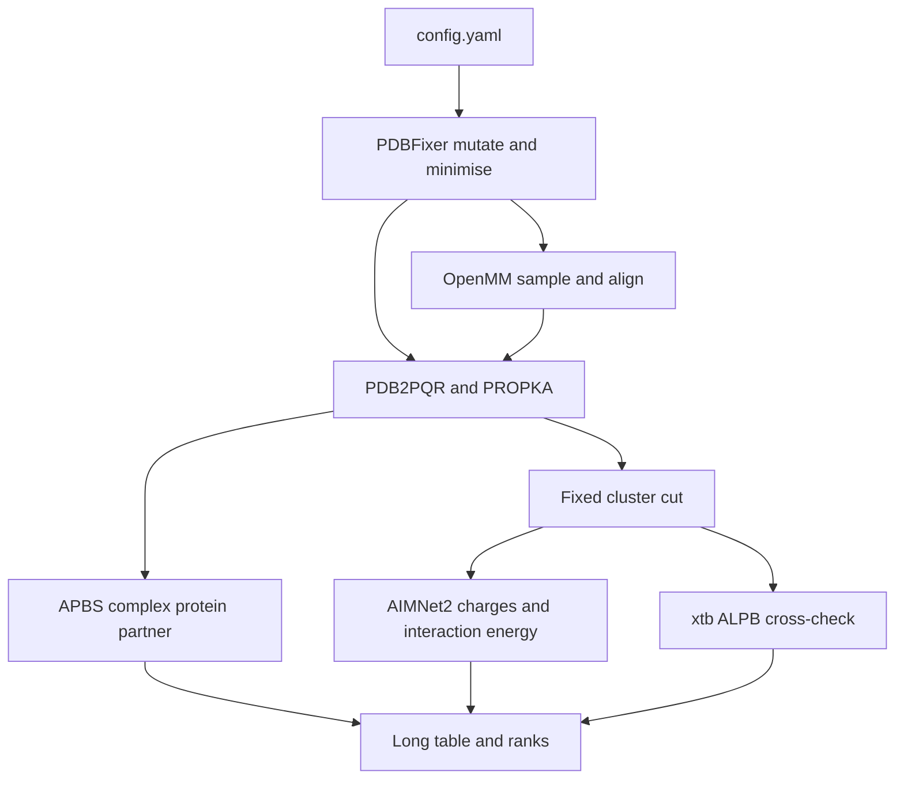

# Residue substitution electrostatics on Modal

Implement the Oct 27 build plan as a thin orchestration layer in this repo. Solvers stay upstream projects. This repo owns configuration, file layout, charge and grid checks, and the merged table.

## What we will not reimplement

Each large component is a pinned install of a public repository. FoldX and Rosetta are out: they are not freely cloneable.

- Protonation: [Electrostatics/pdb2pqr](https://github.com/Electrostatics/pdb2pqr) (bundles PROPKA 3). One `pdb2pqr30` call per frame writes `.pqr`, `.pka`, and the protonated PDB.
- Poisson–Boltzmann: [Electrostatics/apbs](https://github.com/Electrostatics/apbs). Three runs per frame (complex, protein, partner) with identical `dime`, `glen`, and `gcent`.
- Prep and mutation: [openmm/pdbfixer](https://github.com/openmm/pdbfixer). Alternate locations, missing atoms, and the single-site substitution.
- Sampling: [openmm/openmm](https://github.com/openmm/openmm) plus [openmm/openmmforcefields](https://github.com/openmm/openmmforcefields), analyzed with [mdtraj/mdtraj](https://github.com/mdtraj/mdtraj).
- Electronic branch: [isayevlab/AIMNet2](https://github.com/isayevlab/AIMNet2) through [ase-developers/ase](https://github.com/ase-developers/ase). Python 3.11 or 3.12.
- Cross-check: [grimme-lab/xtb](https://github.com/grimme-lab/xtb) GFN2 with ALPB water, on two or three clusters only.
- Grids: [MDAnalysis/GridDataFormats](https://github.com/MDAnalysis/GridDataFormats).

ChimeraX stays a local viewer. The pipeline writes `.dx` files and does not install ChimeraX on Modal.

## Layout

New package at [`electrostatics/`](electrostatics/), separate from the surveillance scripts in [`src/`](src/). Heavy products (trajectories, `.dx`, `.pqr`) go to a Modal Volume `electrostatics-results`, not git. Downloaded summaries land in `electrostatics/results/`.

```
electrostatics/
  config.example.yaml
  app.py                 # Modal images, volume, map entrypoints
  src/
    prepare.py           # clean, mutate, restrained minimise, align
    sample.py            # OpenMM; added after the vertical slice
    protonate.py         # pdb2pqr wrapper and pKa parse
    apbs_run.py          # write .in from config, parse ELEC, sample points
    cluster.py           # fixed residue list, caps, fragment split
    aimnet_run.py
    xtb_check.py
    aggregate.py         # long table -> mean, sd, rank
  tests/
```

`config.yaml` is the only place for pH, ionic strength, dielectrics, temperature, grid centre and dimensions, cluster residue list, common-atom selection, and the variant list. Every script reads it. APBS input is generated from that file, and a run aborts if the written grid block differs across complex, protein, and partner.

Per-frame tree matches the build plan: `structures/`, `frames/<variant>/`, `prot/`, `apbs/`, `clusters/`, `aimnet/`, `results/`. The results table is long-format: one row per variant, frame, and quantity. The ranked table is a groupby of that file.

## Modal split

One conda environment cannot hold these stacks. AIMNet2 needs Python 3.11 or 3.12 and a CUDA torch build; APBS and PDB2PQR are CPU binaries; OpenMM wants the CUDA image. Three pinned Modal images, versions written next to the results:

- `classical` (CPU): pdb2pqr, apbs, mdtraj, numpy, pandas, gridData, pdbfixer
- `md` (GPU): OpenMM CUDA, pdbfixer, mdtraj
- `aimnet` (GPU, Python 3.11): torch, aimnet, ase
- `xtb` (CPU): xtb and xtb-python, invoked for the cross-check only

Follow the image-plus-volume pattern already in [`src/esmfold2.py`](src/esmfold2.py). A local `modal run` submits one function per (variant, frame). PDB2PQR and APBS use `.map` on CPU. OpenMM and AIMNet2 request a small GPU (L4 or T4). AIMNet2 clusters are a few hundred atoms, so the GPU that matters is the MD image, as the build plan says.

Both branches consume the same protonation assignment. APBS output is never an AIMNet2 input. They meet only in `aggregate.py`.



## Calculation rules baked into the wrappers

- Compare only atoms shared by every variant: partner contact atoms, backbone at the substituted position, and fixed interface sample points. Do not report charges on the substituted side chain.
- Grid is centred on the interface in the wild-type frame. Fine spacing at or below 0.5 Å, solute dielectric 2–4, solvent 78.5, ionic strength 0.15 M. `ΔΔG_elec` is `(complex − protein − partner)` minus the wild-type value. Absolute ELEC energies are stored and never ranked.
- Cluster membership is a residue list stored in config, built once from the wild-type 8 Å neighborhood. It is not recomputed per variant. Caps are identical. Total charge passed to AIMNet2 is the net charge parsed from the PDB2PQR log, and the run fails if they disagree.
- Refuse the quantum branch if the cluster contains an element outside AIMNet2’s 14 (any metal). That failure is explicit in the manifest.
- Flag any titratable group within 12 Å whose protonation state at the working pH differs across variants. Keep both states available rather than silently picking one.
- Record alignment RMSD in a per-variant manifest. Frames above the config RMSD cutoff are excluded before APBS.

## Build order

Stop after each step and look at the table before writing the next stage. This matches the build plan’s vertical slice.

1. **Vertical slice.** Wild type plus one substitution, one PDBFixer structure each, no MD. Run protonation, the three APBS jobs, cluster cut, and AIMNet2. Emit a two-row table and a wild-type-minus-variant `.dx`. This is the integration test.
2. **Classical scale.** Same APBS and PROPKA path over the configured variant list. Still one minimized structure per variant.
3. **Noise floor.** Add OpenMM only here. Short restrained explicit-solvent sampling, 5–10 aligned frames, wild type repeated on two independent frame sets. Spread on that repeat is the noise floor. If variant gaps sit inside it, do not add the quantum branch yet; lengthen or restrain sampling.
4. **Quantum at the same frames.** Cutoff check at 6, 8, and 10 Å on one variant, then AIMNet2 on the chosen cutoff. xtb/ALPB on two or three clusters.
5. **Readout.** Mean and standard deviation across frames, rank plot of `ΔΔG_elec` against `ΔE_int`.

Default sampling, once step 3 starts: restrain the outer shell and simulate the interface neighborhood rather than an unrestrained trajectory of an entire polymerase-sized complex. Full-complex 5–20 ns per variant is a config change, not the default.

## Checks

Small local tests parse fixture APBS logs, assert the three-job grid block is identical, and check `ΔΔG` arithmetic. On Modal, the vertical slice is the end-to-end check: each stage leaves a file that opens, net charge matches, and alignment RMSD is finite. No solver physics is reimplemented in tests.

## Defaults until you say otherwise

- Code lives in this repo under `electrostatics/`. The biological system is only in `config.yaml`.
- Working pH is 7.0, one pH.
- Bulk crystallographic waters are removed. Waters inside the cluster cutoff of the interface are an explicit list in config, and that list is the later sensitivity switch.
- Step 1 does not spend GPU time on MD. The `md` image is built in step 3.
